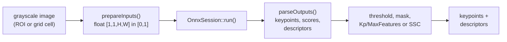
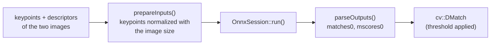

# ONNX Runtime backends: OnnxDetector and OnnxMatcher

RTAB-Map can run learned local features and matchers exported to
[ONNX](https://onnx.ai) with [ONNX Runtime](https://onnxruntime.ai), without
Python or libtorch at runtime:

* **OnnxDetector** (`Kp/DetectorStrategy=17`, `Vis/FeatureType=17`): a
  detector/descriptor, e.g. SuperPoint, ALIKED, DISK.
* **OnnxMatcher** (`Vis/CorNNType=10`): a matcher, e.g. LightGlue.

Both take a model path as parameter and work with any model following the
interfaces below, so adding a new (or re-trained) model doesn't need C++
changes. A model with another interface can be supported by subclassing them
(see [Specializing](#specializing)).

## How it works

Detection, in `OnnxDetector` (a `Feature2D`, `Kp/DetectorStrategy=17`):



Matching, in `OnnxMatcher` (used by `RegistrationVis` when `Vis/CorNNType=10`):



Both `run()` calls go through an `OnnxSession` that holds the `Ort::Session`
of the model and is shared by every object using the same model and options.

* **OnnxSession** ([OnnxSession.h](OnnxSession.h)) wraps ONNX Runtime: the
  one `Ort::Env` of the process (its logging level follows ULogger's), an
  `Ort::Session` per model with the requested execution provider (CUDA and
  TensorRT are appended when the library has them, CPU is the fallback), the
  description of the model's inputs/outputs (names, element types, shapes with
  -1 for dynamic dimensions) and `run()`. Sessions are cached by model path
  and options and shared through `std::shared_ptr`: RTAB-Map creates a
  `Feature2D` per `RegistrationVis`, `Memory`, odometry... each of them would
  otherwise load its own copy of the model (and build its own TensorRT
  engine). Tensors are exchanged as `OnnxTensor` (name, shape, type and a
  plain data vector), so nothing outside `OnnxSession.cpp` includes the ONNX
  Runtime headers.
* **OnnxDetector** ([OnnxDetector.h](OnnxDetector.h)) is a `Feature2D`:
  `generateKeypointsImpl()` converts the (ROI of the) grayscale image to the
  model's input tensor (`prepareInputs()`), runs the session, reads the
  keypoints/scores/descriptors (`parseOutputs()`), then applies the threshold,
  the mask, `Kp/MaxFeatures` (per grid cell, by response or SSC) and keeps the
  descriptors for `generateDescriptorsImpl()`, which returns them when called
  with the same keypoints (there is no separate "compute" pass in these
  networks: keypoints and descriptors come from the same inference, like
  `PyDetector`). `Features2d.cpp` creates it for type 17 and skips its own
  keypoint limiting for it, as for `PyDetector`.
* **OnnxMatcher** ([OnnxMatcher.h](OnnxMatcher.h)) is used by
  `RegistrationVis` when `Vis/CorNNType=10`, in the same branch as
  `PyMatcher` (6) and GMS (7): the descriptors must be float and the image
  size known, otherwise brute force matching is used. `match()` normalizes the
  keypoints with the image size, copies the descriptors, runs the session and
  turns `matches0`/`mscores0` into `cv::DMatch` (query = the "to" signature,
  train = the "from" one, as for the other matchers). Multi-camera signatures
  are supported (as with `PyMatcher`): their keypoints are in the
  side-by-side image, which is what the matcher gets as image size, so all the
  cameras are matched in one inference; keep in mind that LightGlue was
  trained on single images.
* The model interfaces below are the only coupling between RTAB-Map and a
  network: a new or re-trained detector/matcher exported with them only needs
  its path in `OnnxDetector/ModelPath` or `OnnxMatcher/ModelPath`.

## ONNX, ONNX Runtime and other runtimes

ONNX is only the model file format (graph and weights, vendor neutral); a
runtime is needed to execute it. RTAB-Map uses ONNX Runtime, which delegates
the execution to an *execution provider* selected with `Onnx/Provider`:

```
PyTorch --export--> model.onnx --> ONNX Runtime --> CPU      (default, any platform)
                                                 --> CUDA     (NVIDIA)
                                                 --> TensorRT (NVIDIA, compiled engine)
                                                 --> OpenVINO (Intel)   not supported yet
                                                 --> CoreML   (Apple)   not supported yet
```

The same `.onnx` file works with every provider; only the speed changes (and,
with `Onnx/TensorRTFp16`, the precision). Operations a provider doesn't
support are run on the CPU by ONNX Runtime automatically.

* **TensorRT** doesn't run the ONNX graph as is: it compiles it into an
  *engine* optimized for the GPU it runs on (fused layers, kernels benchmarked
  per layer), which is why the first start takes seconds to minutes (a warning
  is logged) and why the engines are cached in `Onnx/TensorRTCachePath`. With
  `Onnx/TensorRTFp16`, the engine may compute in 16-bit floats instead of
  32-bit: faster on GPUs with Tensor Cores and half the memory, at the cost of
  slightly different scores (keypoints near the threshold) and descriptors,
  and some models don't survive it (SuperGlue's Sinkhorn iterations overflow,
  see [Benchmarking](#benchmarking-the-implementations)). Compare with and
  without it on your data (`test_superpoint_perf`, `test_matcher_perf`, or
  the inlier ratio of `rtabmap-matcher`) before enabling it. The FP32 and
  FP16 engines are cached side by side (the file names carry `_fp16`).
* **OpenVINO** is Intel's inference engine (Intel CPUs, integrated and Arc
  GPUs, NPUs), the Intel counterpart of TensorRT. It reads `.onnx` files
  directly, and ONNX Runtime has an OpenVINO execution provider, so it would
  only need a new `Onnx/Provider` value appending `"OpenVINO"` in
  `OnnxSession` (with `device_type` `CPU`, `GPU` or `NPU`). The provider is not
  in the standard ONNX Runtime release archives: it needs Intel's
  onnxruntime-openvino build or ONNX Runtime built with `--use_openvino`.
  Worth it on Intel machines without an NVIDIA GPU.
* **iOS**: ONNX Runtime is distributed for iOS as `onnxruntime.xcframework`
  (CocoaPods `onnxruntime-c`, or the onnxruntime-swift-package-manager
  releases) with the same C++ API, so `OnnxDetector`/`OnnxMatcher` should work
  on the CPU provider without code changes, the `.onnx` file shipped as an app
  bundle resource and `OnnxDetector/ModelPath` set to its path in the bundle.
  `FindONNXRuntime` would need to handle the framework layout. The CoreML
  provider (Neural Engine/GPU) would be one more `Onnx/Provider` value
  (`AppendExecutionProvider("CoreML", {{"ModelFormat", "MLProgram"}})`); it
  works best with fixed input sizes (`--height`/`--width` and, for the
  detectors that have it, `--max-keypoints` in the export scripts), and the
  ops CoreML doesn't support (e.g. `NonZero` of the threshold) fall back to
  the CPU. Not tested yet.

## Building

```bash
cmake -DWITH_ONNXRUNTIME=ON ..
```

ONNX Runtime is found either installed in a standard prefix, or in an
extracted [release archive](https://github.com/microsoft/onnxruntime/releases)
given with `-DONNXRUNTIME_ROOT=/path/to/onnxruntime-linux-x64-1.23.2`
(`onnxruntime-linux-x64-gpu-<version>` for CUDA/TensorRT support, which needs
the matching CUDA and cuDNN versions, see the
[CUDA provider requirements](https://onnxruntime.ai/docs/execution-providers/CUDA-ExecutionProvider.html#requirements)).
The CMake summary shows `With ONNX Runtime = YES` and `rtabmap --version`
shows `With ONNX Runtime: true`. The library is loaded at runtime from the
same location: keep the archive where it was, or add its `lib/` directory to
`LD_LIBRARY_PATH`.

## Parameters

| Parameter | Default | Description |
|---|---|---|
| `OnnxDetector/ModelPath` | | [Required] Path to the ONNX model of the detector. |
| `OnnxDetector/Threshold` | 0 | Keep only keypoints with a score above this threshold (0: only the model's own threshold applies). |
| `OnnxMatcher/ModelPath` | | [Required] Path to the ONNX model of the matcher. |
| `OnnxMatcher/Threshold` | 0.1 | Minimum score of a match (when the model outputs scores). |
| `OnnxDescriptor/ModelPath` | | [Required] Path to the ONNX model of the global descriptor (`Mem/GlobalDescriptorStrategy=2`). |
| `OnnxDescriptor/Dim` | 0 | Keep the first values of the descriptor, re-normalized (0: all). |
| `Onnx/Provider` | 1 | Execution provider of all three: 0=CPU, 1=CUDA, 2=TensorRT. A provider not available in the ONNX Runtime library, or failing to load (missing cuDNN, no device...), falls back to CPU with a warning. |
| `Onnx/TensorRTFp16` | false | Build the TensorRT engines in FP16. |
| `Onnx/TensorRTCachePath` | | Directory caching the TensorRT engines (building one takes seconds to minutes; a warning is logged when it happens). Empty: the `tensorrt_cache` folder of the RTAB-Map working directory. |

The usual feature parameters apply: `Kp/MaxFeatures` / `Vis/MaxFeatures` (the
strongest keypoints are kept, or `Kp/SSC` for a uniform distribution), the
ROI, grid and depth filtering ones. The matcher works with any detector giving
float descriptors, but the model must have been trained with them (e.g.
SuperPoint-LightGlue with SuperPoint descriptors, 256-d).

Example with the models from the [LightGlue-ONNX](https://github.com/fabio-sim/LightGlue-ONNX)
releases (`superpoint.onnx` of v1.0.0 and `superpoint_lightglue.onnx` of
v0.1.3, magicleap weights: non-commercial use; `disk.onnx` and
`disk_lightglue.onnx` are the Apache-2.0 pair; the unit tests use both pairs):

```bash
rtabmap-matcher --Vis/FeatureType 17 --OnnxDetector/ModelPath superpoint.onnx \
                --Vis/CorNNType 10 --OnnxMatcher/ModelPath superpoint_lightglue.onnx from.png to.png

rtabmap --Kp/DetectorStrategy 17 --Vis/FeatureType 17 --OnnxDetector/ModelPath superpoint.onnx \
        --Vis/CorNNType 10 --OnnxMatcher/ModelPath superpoint_lightglue.onnx --Kp/NNStrategy 3
```

The SuperPoint-LightGlue end-to-end "pipeline" models of LightGlue-ONNX (two
images in, matches out) cannot be used: RTAB-Map extracts the features of each
image once and matches them later against many images.

## Detector interface

The interface is the one of the extractors exported by LightGlue-ONNX, and of
[export_superpoint_onnx.py](export_superpoint_onnx.py) below.

**Input** (one tensor), the image:

* `float32 [1,1,H,W]`: grayscale, intensities scaled to [0,1];
* or `uint8 [1,1,H,W]`: grayscale, raw intensities;
* `[1,3,H,W]` (the grayscale image is replicated on the 3 channels) and
  `[1,H,W,1]` layouts are accepted too.

RTAB-Map always extracts features from grayscale images (`Feature2D`
takes a `CV_8UC1` image and its callers convert the color frame first), so a
network trained on RGB (DISK, ALIKED, XFeat...) gets the gray image on its 3
channels. This works in practice (it is how ALIKED was exported and tested
in [#1796](https://github.com/introlab/rtabmap/pull/1796)), but passing color
would need a color path in `Feature2D` and its callers, with a BGR to RGB swap
in `prepareInputs()`.

`H` and `W` may be dynamic (preferred: the image is processed at its
resolution, the one of each grid cell with `Kp/GridRows`/`Kp/GridCols`) or
fixed (the image is resized to the model's size and the keypoints are scaled
back).

**Outputs**, found by name, or by shape when the names differ (the leading
batch dimension is optional):

* `keypoints` `[1,N,2]` (`float32` or `int64`): x,y pixel coordinates, or
  `[1,N,4]` with the keypoint size (pixels) and orientation (radians) too;
* `scores` `[1,N]` `float32` (optional): keypoint responses;
* `descriptors` `[1,N,D]` `float32`: one descriptor per keypoint.

Non-maximum suppression and the detection threshold are expected to be in the
model, where they run fast (on the GPU with CUDA/TensorRT).
`OnnxDetector/Threshold` is a second filter on `scores`, then the keypoints
are limited to `Kp/MaxFeatures` by response (or SSC). Like `PyDetector`, the
descriptors are computed with the keypoints: `generateDescriptors()` must be
called with the keypoints returned by `generateKeypoints()` on the same image
(which is what RTAB-Map does).

## Matcher interface

The interface is the one of the matchers exported by LightGlue-ONNX, and of
[export_lightglue_onnx.py](export_lightglue_onnx.py) below.

**Inputs**, found by name, or by position in this order when the names
differ:

* `kpts0` `float32 [1,M,2]` and `kpts1` `float32 [1,N,2]`: the keypoints of
  the query and train images, normalized like LightGlue does, i.e. for an
  image of size (w,h): `(x - w/2) / (max(w,h)/2)` and
  `(y - h/2) / (max(w,h)/2)`. RTAB-Map does the normalization from the pixel
  coordinates with the image size (the side-by-side image size with multiple
  cameras), the model must not do it again. A model trained with the keypoint
  scale and orientation (LightGlue for SIFT or DoG-HardNet) declares them
  `[1,M,4]`: the two extra columns are `cv::KeyPoint::size` (not normalized)
  and `cv::KeyPoint::angle` in radians, 0 when the detector doesn't compute
  it.
* `desc0` `float32 [1,M,D]` and `desc1` `float32 [1,N,D]`: their descriptors,
  as returned by the detector;
* optionally `scores0` `float32 [1,M]` and `scores1` `float32 [1,N]`: the
  keypoint detection scores (`cv::KeyPoint::response`), for the models that
  take them (SuperGlue).

**Outputs**, found by name, or by shape when the names differ (the leading
batch dimension is optional):

* `matches0` `int64 [1,M]`: for each query keypoint, the index of the matched
  train keypoint or -1, with optionally `mscores0` `float32 [1,M]`, the
  confidence of each match;
* or `matches` `int64 [K,2]`: (query, train) index pairs, with optionally
  `mscores` `float32 [K]`.

Other outputs (e.g. `matches1`, `mscores1`) are ignored. When the scores are
there, matches with a score below `OnnxMatcher/Threshold` are dropped and
`cv::DMatch::distance` is `1 - score`.

## Global descriptor interface

`OnnxDescriptor` (`Mem/GlobalDescriptorStrategy=2`) extracts a global (whole
image) descriptor, like `PyDescriptor` does with a python script. The model
takes one image, `float32 [1,3,H,W]` RGB in [0,1] (or `[1,1,H,W]` grayscale;
`uint8` and `[1,H,W,C]` accepted; a fixed size gets the image resized), and
returns the descriptor as its first output, `float32` with `D` values
(`[1,D]`). `OnnxDescriptor/Dim` keeps the first values and re-normalizes them
(0: the whole descriptor), like `PyDescriptor/Dim`. See
[export_netvlad_onnx.py](export_netvlad_onnx.py) below.

## Getting models

Pre-exported models following these interfaces (SuperPoint, DISK, ALIKED and
LightGlue, Apache-2.0 code but check the license of each network's weights,
e.g. SuperPoint's, from magicleap, are for non-commercial use) are in the
[LightGlue-ONNX releases](https://github.com/fabio-sim/LightGlue-ONNX/releases):
use the extractor files (`superpoint.onnx`, `disk.onnx`, ...) and the matcher
files (`superpoint_lightglue.onnx`, `disk_lightglue.onnx`, ... of the releases
before v2.0, later releases only have the end-to-end pipelines), not the
`end2end` / `pipeline` ones.

### Export scripts

The scripts here are RTAB-Map's own (not copies of the LightGlue-ONNX ones,
which export fused image-pair pipelines and keep their own copies of the
networks). Each one loads the original PyTorch implementation of a network
family and wraps it in a small `nn.Module` whose `forward()` has the
interface above, then calls `torch.onnx.export()` with dynamic axes for the
number of keypoints (and the image size), checks the model with `onnx` and,
when `onnxruntime` is installed, runs it to compare its outputs with the
PyTorch ones. There is one script per network, not per detector/matcher
combination:

* the detector script wraps the network's dense outputs (score map,
  descriptor map) with an export-friendly post-processing (softmax,
  depth-to-space, NMS by max-pooling, border mask, threshold with
  `torch.nonzero`, optional top-k, bilinear descriptor sampling) since the
  original post-processing uses Python loops and in-place slices that don't
  export;
* the matcher script takes the feature type as argument: LightGlue is one
  architecture with a checkpoint per descriptor type (`superpoint_lightglue`,
  `disk_lightglue`, `aliked_lightglue`, ...), so `aliked_lightglue.onnx` is the
  same script with `--features aliked`. The matcher only has to match the
  descriptors it was trained with, it doesn't care which detector
  implementation produced them.

A detector not covered here (e.g. ALIKED, see #1796 for an exporter) needs its own script
on the same pattern: load the network, write a `forward(image)` returning
`keypoints [1,N,2]`, `scores [1,N]`, `descriptors [1,N,D]`, export with the
same `input_names`/`output_names`/`dynamic_axes`. A model exported with
another interface can also be used by subclassing `OnnxDetector` (see
[Specializing](#specializing)) instead of changing the export.

The scripts need `torch` and `onnx` (`onnxruntime` to verify the exported
model); they were written for torch 2.11 and use the TorchScript-based
exporter (`dynamo=False`). Where that exporter mishandles an operation with
dynamic sizes (LightGlue's `unflatten`, `einsum` and literal negative
indices, XFeat's `unfold`), the scripts substitute an equivalent
implementation for the export only, and the verification step compares the
exported model with the original code.

### SuperPoint

[export_superpoint_onnx.py](export_superpoint_onnx.py) exports the SuperPoint
of [rpautrat/SuperPoint](https://github.com/rpautrat/SuperPoint) (MIT
license, `superpoint_pytorch.py` + `weights/superpoint_v6_from_tf.pth`) or of
[magicleap/SuperPointPretrainedNetwork](https://github.com/magicleap/SuperPointPretrainedNetwork)
(non-commercial license, `demo_superpoint.py` + `superpoint_v1.pth`), with
the NMS, detection threshold, border removal and optional top-k inside the
model.

**Which SuperPoint goes with which LightGlue?** A LightGlue checkpoint is
trained on the descriptors of one specific network, and the two SuperPoint
weights above are different trainings whose descriptors don't live in the
same space. cvg/LightGlue's `superpoint` checkpoint (the one in
`superpoint_lightglue.onnx` from LightGlue-ONNX, and the one
[export_lightglue_onnx.py](export_lightglue_onnx.py) exports) was trained with
the **magicleap** weights, which is also what LightGlue-ONNX's `superpoint.onnx`
was exported from. So:

* magicleap SuperPoint (release file or `export_superpoint_onnx.py` on
  `superpoint_v1.pth`) + `superpoint_lightglue.onnx`: consistent;
* rpautrat SuperPoint (MIT) + `superpoint_lightglue.onnx`: mismatched, expect
  degraded matching. Use it with the nearest neighbor matchers
  (`Vis/CorNNType` 0-5) or train a LightGlue on it with
  [glue-factory](https://github.com/cvg/glue-factory) and export that.

To check a detector/matcher pair, match an image with a shifted copy of
itself: `rtabmap-matcher` prints the inliers/matches ratio, which should be
close to 1 for a consistent pair and collapse for a mismatched one (this is
what `test_onnx` does with `OnnxMatcher.TranslatedImageMatches`).

Exports:

```bash
git clone https://github.com/rpautrat/SuperPoint.git
python3 export_superpoint_onnx.py --model-dir SuperPoint --weights SuperPoint/weights/superpoint_v6_from_tf.pth --output superpoint_rpautrat.onnx

git clone https://github.com/magicleap/SuperPointPretrainedNetwork.git
python3 export_superpoint_onnx.py --model-dir SuperPointPretrainedNetwork --weights SuperPointPretrainedNetwork/superpoint_v1.pth --output superpoint_magicleap.onnx
```

Options: `--nms-radius 4`, `--threshold 0.005`, `--remove-borders 4`,
`--max-keypoints 0` (0: all), `--height`/`--width` (fixed input size, for
TensorRT or other runtimes needing static shapes).

### DISK

[export_disk_onnx.py](export_disk_onnx.py) exports
[DISK](https://github.com/cvlab-epfl/disk) (Apache-2.0, 128-d descriptors)
from kornia's implementation and pretrained weights, the ones cvg/LightGlue
uses, so the result pairs with `disk_lightglue.onnx` (LightGlue-ONNX release
or `export_lightglue_onnx.py --features disk`). The model takes an RGB image
(RTAB-Map replicates its grayscale image on the 3 channels) and has the
padding to a multiple of 16, the NMS, the threshold and the optional top-k
inside:

```bash
pip install kornia
python3 export_disk_onnx.py --output disk.onnx
```

Options: `--weights depth|epipolar|file.pth`, `--window-size 5`,
`--threshold 0`, `--max-keypoints 0`, `--height`/`--width`.

### XFeat

[export_xfeat_onnx.py](export_xfeat_onnx.py) exports
[XFeat](https://github.com/verlab/accelerated_features) (Apache-2.0, 64-d
descriptors, designed for CPU speed) from a clone of its repository, which
holds the weights. It reproduces XFeat's sparse `detectAndCompute()` (NMS,
heatmap times reliability scores, top-k, descriptors interpolated from the
1/8 feature map) with a grayscale input, which XFeat uses internally anyway;
the one difference is that an image whose size is not a multiple of 32 is
zero-padded rather than resized down, so the keypoints stay in the image's
coordinates. XFeat has no LightGlue checkpoint (it has its own
LighterGlue, not supported here): match its descriptors with the nearest
neighbor matchers (`Vis/CorNNType` 0-5):

```bash
git clone https://github.com/verlab/accelerated_features.git
python3 export_xfeat_onnx.py --model-dir accelerated_features --output xfeat.onnx
```

Options: `--threshold 0.05`, `--max-keypoints 4096` (XFeat's defaults),
`--interpolation bicubic|bilinear` (descriptor sampling; bicubic is XFeat's,
bilinear is faster on GPU providers), `--height`/`--width`.

### LightGlue

[export_lightglue_onnx.py](export_lightglue_onnx.py) exports the LightGlue of
[cvg/LightGlue](https://github.com/cvg/LightGlue) (Apache-2.0) for a given
feature type (`superpoint`, `disk`, `aliked`, `sift`, `doghardnet`, their
weights are downloaded by LightGlue itself) or for your own checkpoint
(`--weights model.pth --input-dim D`, e.g. trained with
[glue-factory](https://github.com/cvg/glue-factory)), with the adaptive depth
and width (early stopping and point pruning, which a static graph cannot
express) disabled. The `sift` and `doghardnet` ones take the keypoint scale
and orientation (`kpts` with 4 columns), which RTAB-Map fills from the
OpenCV keypoints, e.g. `sift_lightglue.onnx` with `Vis/FeatureType=1`:

```bash
pip install git+https://github.com/cvg/LightGlue.git  # or: git clone it and use --lightglue-dir
python3 export_lightglue_onnx.py --features superpoint --output superpoint_lightglue.onnx
```

Options: `--threshold 0.1` (match threshold inside the model, matches below it
are returned as -1), `--lightglue-dir` (a clone of the repository, to avoid
installing it and its dependencies), `--weights`/`--input-dim`/`--scale-ori`
(a custom checkpoint, its descriptor dimension and whether it was trained with
the keypoint scale and orientation).

### NetVLAD

[export_netvlad_onnx.py](export_netvlad_onnx.py) exports NetVLAD (VGG16 +
NetVLAD + PCA whitening, the Pittsburgh 30k weights of the
[original release](https://github.com/Relja/netvlad) converted to a MATLAB
struct by netvlad_tf_open and hosted by hloc, whose extractor the script
follows) to a model of the global descriptor interface, replacing the
TensorFlow-based `rtabmap_netvlad.py` of `PyDescriptor`:

```bash
pip install scipy torchvision
python3 export_netvlad_onnx.py --download --weights Pitts30K_struct.mat --output netvlad.onnx --dim 1024
```

`--model TokyoTM` downloads the Tokyo Time Machine weights instead.

The script reads the two `_struct.mat` files hosted by hloc
(`Pitts30K_struct.mat`, `TokyoTM_struct.mat`): the
`vd16_*_conv5_3_vlad_preL2_intra_white` models of the NetVLAD
[project page](https://www.di.ens.fr/willow/research/netvlad/) converted
from MATLAB class objects to plain structs with `net_class2struct` of
[netvlad_tf_open](https://github.com/uzh-rpg/netvlad_tf_open), which needs
MATLAB and MatConvNet. The other models of the page (no whitening, AlexNet
backbone, max pooling) are not supported as is. The NetVLAD code is MIT
(original release) and Apache-2.0 (hloc); the project page provides the
weights "on a non-commercial basis" without an explicit license, check
these terms before redistributing a model built from them. `--dim` keeps the leading PCA components (default 4096, the full whitening):
the whitening matrix is 32768 x dim floats, on top of the 59 MB VGG16
backbone (596 MB at 4096, 193 MB at 1024, 126 MB at 512);
`OnnxDescriptor/Dim` can truncate further at runtime. The weights file is 555 MB. Usage, as with the python
version: `--Mem/GlobalDescriptorStrategy 2 --OnnxDescriptor/ModelPath
netvlad.onnx --Kp/TfIdfLikelihoodUsed false --Mem/RehearsalSimilarity 1`.
With `Kp/TfIdfLikelihoodUsed=false`, the loop closure likelihood is the dot
product of the descriptors (`Signature::compareTo()`), rescaled to [0,1].
Note that every node then gets a non-zero likelihood, unlike with the
bag-of-words, which keeps the Bayes filter hypotheses low with the default
`Rtabmap/VirtualPlaceLikelihoodRatio=0`: see the test
`OnnxDescriptor.NetVLADAppearanceOnlyLoopClosure` for the retrieval
quality on `data/samples` and the resulting hypothesis values.

### SuperGlue

[export_superglue_onnx.py](export_superglue_onnx.py) exports
[SuperGlue](https://github.com/magicleap/SuperGluePretrainedNetwork)
(non-commercial license) from a clone of its repository, with the Sinkhorn
iterations unrolled in the graph. SuperGlue takes the keypoint scores too
(`scores0`/`scores1` inputs) and was trained with the magicleap SuperPoint:
pair it with `superpoint_magicleap.onnx` or `SuperPointTorch`.

```bash
git clone https://github.com/magicleap/SuperGluePretrainedNetwork.git
python3 export_superglue_onnx.py --superglue-dir SuperGluePretrainedNetwork --weights indoor --output superglue_indoor.onnx
```

Options: `--weights indoor|outdoor`, `--iterations 20` (Sinkhorn iterations;
`PyMatcher/Iterations` default, SuperGlue's own is 100), `--threshold 0.2`.
The matcher benchmark below compares it with `PyMatcher` running the same
network in Python and with LightGlue.

## Benchmarking the implementations

Two performance tests (built with `BUILD_PERF_TESTS=ON`, run with
`ctest -L performance` or directly from `bin/`) compare the implementations
and the execution providers on the images of `data/samples`. The variants
the build or the machine can't run are skipped; the assets come from
`scripts/fetch_test_data.sh` (torch needed to export some models and to run
the python scripts). The numbers below are from a GeForce RTX 3080 with
512x384 images, up to 1000 keypoints, torch 2.11, ONNX Runtime 1.23.2 and
TensorRT 10.9, the TensorRT engines already cached (their first build takes
seconds to minutes, see "first ms" otherwise).

### Matchers

`test_matcher_perf` compares, on consecutive frames with SuperPoint
(magicleap) features: FLANN kd-tree with the distance ratio test (rtabmap's
default, `Vis/CorNNType=1`, with `Vis/CorNNDR` 0.8 and 0.6), brute force
matching with cross check, LightGlue
(`OnnxMatcher`, CPU/CUDA/TensorRT/TensorRT FP16), SuperGlue exported to ONNX
(`OnnxMatcher`) and SuperGlue run by `PyMatcher` (python, CPU/CUDA), with the
time per pair, the matches and the inliers of a RANSAC fundamental matrix
(19 pairs, LightGlue threshold 0.1, SuperGlue threshold 0.2 and 20 Sinkhorn
iterations):

```
matcher                      device          first ms   mean ms   matches   inliers   inlier %
FLANN kd-tree, NNDR 0.8      cpu                 17.0     16.34        76        43      56.9%
FLANN kd-tree, NNDR 0.6      cpu                 15.9     15.65        16        13      80.4%
brute force cross check      cpu                  9.0      6.46       273        64      23.6%
LightGlue (OnnxMatcher)      cpu                569.5    548.19       139        91      65.7%
LightGlue (OnnxMatcher)      cuda               101.5     18.23       139        91      65.9%
LightGlue (OnnxMatcher)      tensorrt            96.4     10.09       139        91      65.7%
LightGlue (OnnxMatcher)      tensorrt-fp16       98.4      5.18       139        92      66.3%
SuperGlue (OnnxMatcher)      cpu                349.0    340.97       238       122      51.4%
SuperGlue (OnnxMatcher)      cuda               345.1     20.80       237       122      51.4%
SuperGlue (OnnxMatcher)      tensorrt           126.3     10.09       237       124      52.1%
SuperGlue (OnnxMatcher)      tensorrt-fp16       75.3      5.21        26        11      41.8%
SuperGlue (PyMatcher)        cpu                691.0    522.38       238       122      51.4%
SuperGlue (PyMatcher)        cuda               276.5     24.79       238       121      50.9%
```

SuperGlue exported to ONNX gives the same matches as the python
implementation, twice as fast on CPU and the same on CUDA. The learned
matchers find about twice the inliers of the ratio test at a similar inlier
ratio, for a cost that is only acceptable on GPU; on CPU, the kd-tree with
the ratio test remains the sensible choice. A stricter ratio (0.6) raises
the inlier ratio of the kd-tree but keeps too few matches (16 per pair here)
for a registration. TensorRT halves the CUDA time,
and FP16 (`Onnx/TensorRTFp16`) halves it again for LightGlue with the same
matches. SuperGlue breaks in FP16 (26 matches instead of 237): its Sinkhorn
iterations overflow in half precision, as TensorRT warns at build time about
the layer normalizations after the self-attention. This is why FP16 has to
be validated per model.

### Detectors

`test_superpoint_perf` times the implementations of SuperPoint: the python
scripts (`PyDetector`), libtorch (`SuperPointRpautrat` for the rpautrat
weights, `SuperPointTorch` for the magicleap ones) and ONNX Runtime
(`OnnxDetector`) on CPU, CUDA, TensorRT and TensorRT FP16, with the model
load and first frame times, the time per frame, and whether they find the
same keypoints and descriptors:

```
weights    implementation                 device          load ms   first ms   median ms   kpts   same kpts
rpautrat   OnnxDetector                   cpu                31.8      111.6      108.86    235      100.0%
rpautrat   OnnxDetector                   cuda              267.8      193.7        4.93    235       99.8%
rpautrat   OnnxDetector                   tensorrt         2129.3       34.1        2.99    235      100.0%
rpautrat   OnnxDetector                   tensorrt-fp16    1459.6       16.9        1.70    236       98.4%
rpautrat   SuperPointRpautrat (libtorch)  cpu                 0.2     2081.9      200.72    235      100.0%
rpautrat   SuperPointRpautrat (libtorch)  cuda                0.7      348.8        5.26    235       99.8%
rpautrat   PyDetector (python script)     cpu                 1.6      215.2      197.70    235      100.0%
rpautrat   PyDetector (python script)     cuda                0.2       28.9        4.73    235       99.8%
magicleap  OnnxDetector                   cpu                30.6       47.2       46.30    366      100.0%
magicleap  OnnxDetector                   cuda               34.9       18.1        4.79    365       99.9%
magicleap  OnnxDetector                   tensorrt         1592.4       21.2        2.96    366      100.0%
magicleap  OnnxDetector                   tensorrt-fp16    1530.7       18.9        2.01    362       98.3%
magicleap  SuperPointTorch (libtorch)     cpu                12.5      195.7      188.31    362      100.0%
magicleap  SuperPointTorch (libtorch)     cuda               11.7        7.4        6.16    361       99.9%
magicleap  PyDetector (python script)     cpu                28.0      100.2      104.39    366      100.0%
magicleap  PyDetector (python script)     cuda                0.2       24.3        8.28    365       99.9%
```

Within each set of weights, the implementations find the same keypoints
("same kpts" compares each row with the first row of its weights; the test
also reports the cosine similarity of the descriptors, 1.000 everywhere but
for the magicleap python script, whose `demo_superpoint.py` samples them with
another interpolation convention, 0.978); ONNX Runtime is the fastest on CPU
and TensorRT on GPU. FP16 is 1.5x faster again and changes about 2% of the
keypoints (the ones near the detection threshold), with the same descriptors
(cosine similarity 0.999). The two sets of weights are different trainings,
see [SuperPoint](#superpoint) above. The magicleap python script needs a
`cv2` importable by the embedded interpreter (`pip install
opencv-python-headless` in the environment the build uses).

## Specializing

A model with another interface can be supported by subclassing `OnnxDetector`
or `OnnxMatcher` and overriding `prepareInputs()` (model inputs from the image
or features) and/or `parseOutputs()` (keypoints/descriptors or matches from
the model outputs). The tensors are exchanged as `OnnxTensor` (name, shape,
type and data), the subclass doesn't need the ONNX Runtime headers. The
session (`OnnxSession`) is shared between the objects using the same model
and options, so the many `Feature2D`/`RegistrationVis` instances RTAB-Map
creates load the model once. A specialized detector also needs a new
`Feature2D::Type` value, see how `kFeatureOnnxDetector` is handled in
`Features2d.cpp`.
